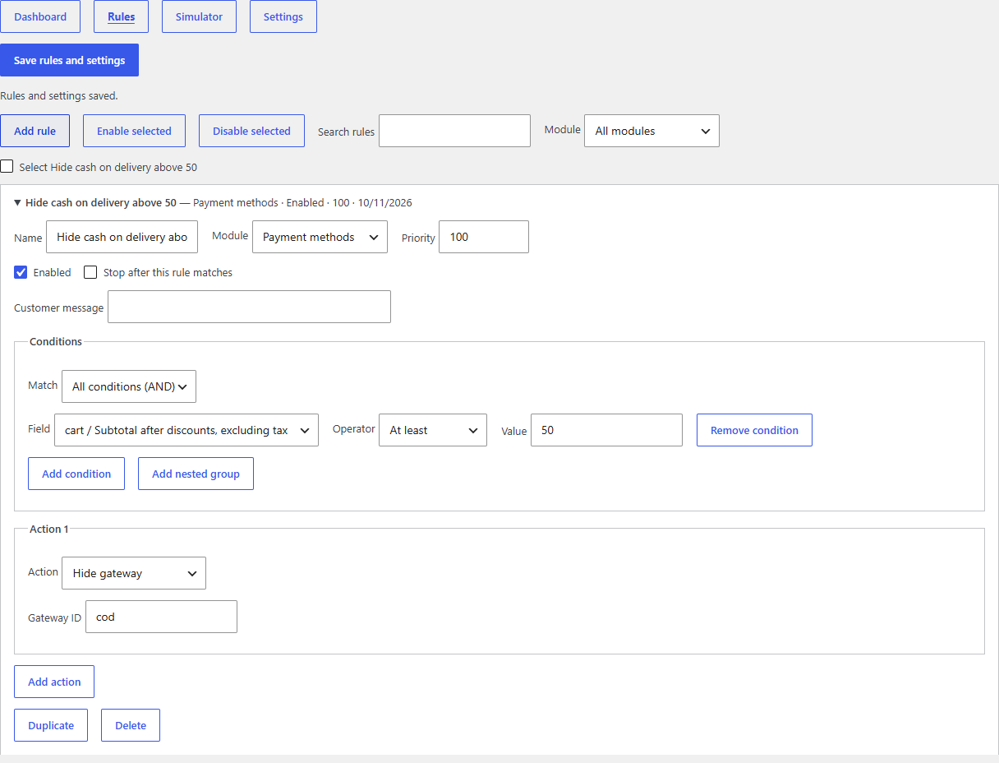

# Smart Checkout Rules

Smart Checkout Rules adds conditional payment methods, checkout field validation, merchandise and quantity limits, and shipping restrictions to WooCommerce. Configure rules under **WooCommerce → Checkout Rules**.

**Author** Previn Kalisetty Appadu · [previn.me](https://previn.me)

**Requirements** WordPress 6.8+, WooCommerce 10.5+, PHP 8.3+

## Installation

1. Download the installable **smart-checkout-rules.zip** from the GitHub release or this repository.
2. In WordPress, activate WooCommerce. Go to **Plugins → Add New Plugin → Upload Plugin**, select the ZIP, then install and activate it.
3. Open **WooCommerce → Checkout Rules**. The plugin starts with no active rules on a fresh install.
4. In **Rules**, select **Add rule**. Choose a module, add conditions and actions, turn on **Enabled**, and select **Save rules and settings**. The **Dashboard** has sample rules you can copy into your draft.
5. In **Simulator**, enter a fictional cart and test the draft. Check the equivalent purchase with your configured gateways, shipping zones, tax and currency settings in a staging store.

## Configure a rule

A group matches **all** conditions (AND) or **any** condition (OR). Add a nested group to combine the two. An empty top-level AND group matches every nonempty cart. In a list condition, **Matches any of** compares one or more values against a comma-separated list. **Matches none of** requires a known, nonempty value. Use **Is empty** for missing input.

Rules run in ascending priority, then by ID. **Stop after this rule matches** stops later rules in the same module and, for shipping, the same package. A matching hide takes precedence over a matching allow. An allow only applies to a gateway WooCommerce already offers. To offer a gateway only to wholesale users, hide it when the role matches none of your wholesale role slugs.

| Goal | Module | Conditions | Action |
| --- | --- | --- | --- |
| Hide cash on delivery at 500 | Payment methods | Cart subtotal after discounts, excluding tax **At least** 500 | **Hide gateway** · cod |
| Set a wholesale minimum of 250 | Order limits | Customer roles **Matches any of** wholesale | **Minimum** · 250 in store currency |
| Collect a purchase order reference for bank transfer | Checkout validation | Checkout payment method **Matches any of** bacs | **Require a field** · Purchase order reference |
| Hide flat rate for oversized goods | Shipping restrictions | Package shipping classes **Matches any of** oversized | **Hide shipping rates** · choose the configured flat-rate instance |
| Restrict local pickup to known states | Shipping restrictions | Destination state **Matches none of** your allowed state codes | **Hide shipping rates** · choose your pickup rate or method ID |

Use product and category IDs, shipping-class slugs, gateway IDs and WooCommerce country/state codes. A shipping method ID such as **flat_rate** matches all its instances. **flat_rate:3** targets one instance or its exact rate ID. A **Keep only quote method** action keeps a rate that an existing extension supplies. Configure that extension before enabling the rule.

The default monetary limit uses merchandise subtotal after discounts, excluding tax, fees and shipping. Choose a pre-discount or tax-inclusive subtotal if needed. Add qualifying product or category IDs to measure matching lines only. If both lists are set, a line must match both. A quantity limit applies regardless of currency. A monetary limit applies in the selected currency, with **store** using the base currency. Configure a separate threshold for each active checkout currency when using a currency switcher. The special value **\*** reuses the same numeric threshold across currencies without conversion. New rules should use an explicit currency or **store**.

Use **Require a field** together with length, pattern or phone validation when the field also needs to be mandatory. Email lists match whole domains. Patterns are matched against the entire value. Phone validation uses WooCommerce’s general phone format check. Configure WooCommerce to show any built-in checkout field you make mandatory. For a separate shipping address, select the shipping field in the builder. The plugin registers the purchase order reference on both checkouts when an active rule targets it.

## Manage rules

- Search and filter the rule list. Select rules to enable or disable them in bulk. Duplicates start disabled.
- In **Settings**, enable or disable modules. Export rules and settings as JSON or import a validated JSON draft. Review and save the draft to apply it.
- The simulator evaluates one shipping package at a time. Enter hypothetical rates and payment options to see which survive. Add simulated lines for scoped limits. It evaluates your rules without creating an order.
- Optional diagnostics appear in **WooCommerce → Status → Logs** under **smart-checkout-rules**. They contain event codes and rule IDs. Avoid putting shopper details or credentials in rule names, customer messages or exports.

## Upgrade and uninstall

The 1.0 rules appear automatically in the new editor. The original subtotal and separate-shipping-address behavior are preserved in migrated rules. Saving creates the new settings revision and retains the old option for rollback. If you restore 1.0, it reads the original rules and does not read changes saved in 2.0.

Deactivation preserves the rules. By default, deletion also preserves them. Enable **Delete plugin configuration on uninstall** and save before deleting if you want to remove the plugin settings. WooCommerce retains existing order data and rotates its logs using its own retention settings.

See [developer reference](docs/developer.md), [test instructions](tests/README.md), [release checklist](docs/release-checklist.md), and [changelog](CHANGELOG.md). Licensed GPL-2.0-or-later.
